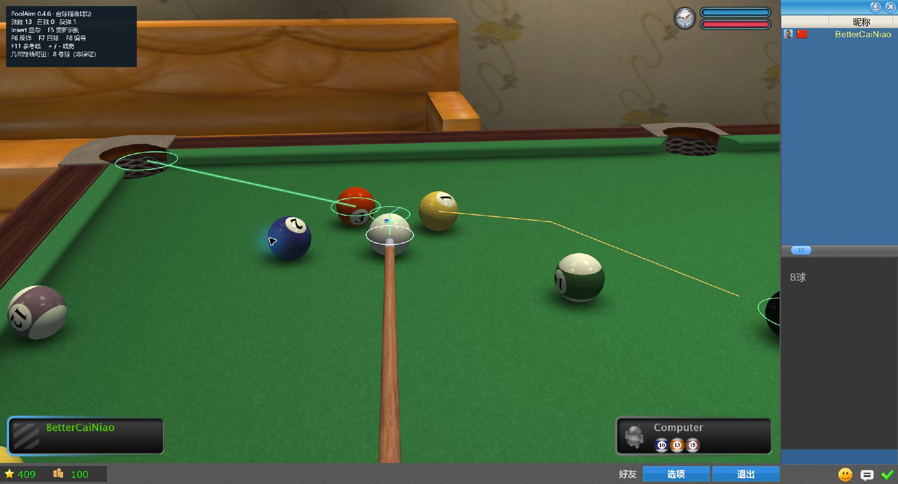
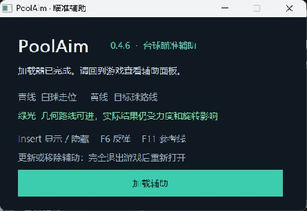
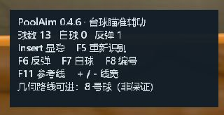

<div align="center">

# 🎱 PoolAim

**Poolians / Real Pool 3D 台球几何瞄准辅助**

看清碰撞 · 预览反弹 · 判断薄切


[**⬇️ 下载最新版**](https://github.com/AuR3L1US07/PoolAim/releases/latest) · [快速开始](#-快速开始) · [效果预览](#-效果预览) · [源码构建](#-源码构建)

</div>

---

## ✨ 功能一览

| 功能 | 说明 |
| :--- | :--- |
| 🎯 瞄准预览 | 读取球坐标与相机矩阵，绘制精简路线 |
| ↪️ 碰撞与反弹 | 预览目标球、传球及碰撞后白球的几何路线 |
| 💚 进球高亮 | 几何模型预测可进球时，突出显示路线与袋口 |
| 🔶 薄切提示 | 双精度碰撞计算；极薄碰撞使用橙色提示 |
| 🇨🇳 中文面板 | 中文启动界面、状态信息与快捷键说明 |
| 📦 单文件启动 | EXE 内置插件、加载器、配置与 MinHook 许可证 |

> **预测范围**：路线未包含完整力度、旋转与摩擦，绿色高亮不代表保证进球。当前版本不包含自动开球或回合判断。

## 🚀 快速开始

1. 在 [Releases](https://github.com/AuR3L1US07/PoolAim/releases/latest) 下载 **PoolAim.exe**。
2. 打开 Poolians，进入 **8 球练习模式**。
3. 运行启动器，点击 **加载辅助**，回到游戏查看路线。

**更新／移除**：完全退出游戏后重新打开。仅关闭启动器或隐藏路线不会卸载已加载的 DLL。

下载页同时提供 `SHA256SUMS.txt`，用于核对 EXE 的 SHA-256 校验值。

## 🖼️ 效果预览

### 游戏内瞄准与进球高亮



**青色**：白球路线　·　**黄色**：碰撞后路线　·　**绿色**：预测可进　·　**橙色**：极薄碰撞

### 中文启动界面



<details>
<summary><strong>查看中文状态面板</strong></summary>

<br>


</details>

## ⌨️ 快捷键

| 按键 | 操作 |
| :---: | :--- |
| `Insert` | 显示／隐藏辅助 |
| `F5` | 重新识别球 |
| `F6` | 切换反弹次数 |
| `F7` | 切换白球编号 |
| `F8` | 显示／隐藏球编号 |
| `F9` / `F10` | 切换参考目标球／袋口 |
| `F11` | 显示／隐藏参考线 |
| `+` / `-` | 调整线宽 |

## 🛠️ 源码构建

普通使用只需下载 EXE。自行构建需要 **Windows + x86 w64devkit 2.10.0**。

从官方 [w64devkit Release](https://github.com/skeeto/w64devkit/releases/tag/v2.10.0) 获取 x86 包，将 `w64devkit` 文件夹放到 `plugin/vendor/toolchain/` 下。源码仓库不包含大型工具链。

在项目根目录执行：

```powershell
# 编译插件与加载器，并运行几何测试
powershell -NoProfile -ExecutionPolicy Bypass -File plugin/build.ps1

# 打包为根目录的 PoolAim.exe
powershell -NoProfile -ExecutionPolicy Bypass -File plugin/package/build-single.ps1
```

| 路径 | 内容 |
| :--- | :--- |
| [`plugin/src`](plugin/src) | 插件、几何计算、中文面板与启动器 |
| [`plugin/tests`](plugin/tests) | 薄切、相切、反弹与进袋几何测试 |
| [`plugin/PoolAim.ini`](plugin/PoolAim.ini) | 桌面尺寸配置 |
| [`plugin/vendor/minhook`](plugin/vendor/minhook) | MinHook 源码与许可证 |
| `plugin/build` / `plugin/dist` | 可重新生成的构建产物 |

更详细的源码说明见 [插件开发文档](plugin/README.md)。

## 📌 使用范围与限制

- 面向 Poolians / Real Pool 3D 的 Windows x86 版本，建议用于练习与几何学习。
- 球桌尺寸、相机方向及 Ogre 对象布局依赖游戏版本，路线需要实际校准。
- 程序使用 DLL 注入与绘图挂接，仅针对 `Poolians.exe`；其他游戏的反作弊兼容性未验证，请勿与带反作弊的游戏同时运行。
- MinHook 的 BSD 许可证见 [LICENSE.txt](plugin/vendor/minhook/LICENSE.txt)。

